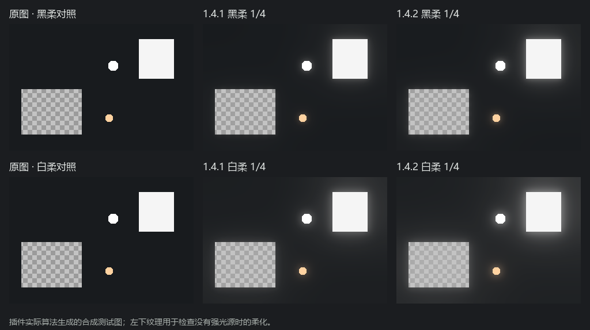

# ThisPC Glow · 这台电脑的插件

Photoshop 柔光与十字星光插件的本地修改版，当前版本 **1.5.1**。基于用户提供的一晨辉光 1.3.1 修改，原作者 **1CHEN**。来源与权利说明见 [CREDITS.md](CREDITS.md)。

## 功能

- 黑柔、白柔各提供 **1/8、1/4、1/2** 三档预设。
- 局部亮度驱动的多尺度散射，保留光源颜色，减少额外的红黄偏色。
- 调整发光范围、柔光浓度、强度、扩散范围、光晕层次、色相与颜色浓度。
- 保留十字星光、用户预设、智能对象保存及再次编辑。
- 深灰与低饱和绿色的极简界面，移除主页的社交平台图标。
- 从当前像素蒙版或选区创建局部柔光；边缘羽化可在预览、保存后继续编辑。
- 附带 Camera Raw 18.5 的三档原生蒙版柔化预设：轻柔、标准、浓柔。

“这台电脑的插件”是项目名称，不表示硬件绑定。当前副本不设置使用到期日期。

## 下载与安装

在 [Releases](https://github.com/zuixihuancaibaole-glitch/thispc-glow/releases) 下载 `thispc-glow-v1.5.1.zip`。其中 `thispc-glow` 是 PS 插件，`camera-raw-local-presets` 是 Camera Raw 的独立预设。

已在 **Windows / Photoshop 2026** 实测。清单声明最低 Photoshop 24.0，但未逐一验证其他版本及 macOS。

1. 保存照片并退出 Photoshop。
2. 解压 ZIP，将其中整个 `thispc-glow` 文件夹放入 Photoshop 安装目录下的 `Plug-ins` 文件夹。确保 `manifest.json` 直接位于插件文件夹内。
3. 如果已安装相同标识 `com.local.thispc.glow` 的版本，先将旧文件夹移到 `Plug-ins` 外备份，避免重复加载。
4. 打开 Photoshop，在 **增效工具 → 这台电脑的插件 → 这台电脑的插件** 中打开面板。
5. 确认面板版本显示 **1.5.1**。该安装方式在本项目测试环境可用；若其他环境不识别，请使用 Adobe 支持的 UXP 开发加载方式加载 `thispc-glow/manifest.json`。

更新时，保留自己的照片和 PSD，只替换插件文件夹。

## 使用

打开照片后点击“创建光效”，选择黑柔或白柔档位，再点击面板中的“保存”，将效果保存为照片中的智能对象图层。Photoshop 文档本身仍需另外保存。

建议先尝试 **1/4 黑柔**；白柔的柔雾更明显，**1/2 白柔**会明显降低局部反差。效果过强时降低“柔光强度”或光效图层不透明度。

编辑已有光效时，先选中光效图层，再点击“编辑光效”。更新插件不会自动改变已保存的光效像素；重新点选预设并保存，才会按新版重新计算。检查光效图层左侧的眼睛是否开启。

1.5.1 修复高光识别控制的响应：“发光范围”在 1–35 的整个区间持续改变识别范围；“柔光饱和度”同时控制光雾浓度，对已经完全识别的白色亮光也有效。这项浓度控制与下方颜色饱和度控制分别生效。旧版问题、参数含义和修复对比见 [高光识别修复说明](docs/highlight-controls.md)。

### 局部柔光与 Camera Raw

PS 中先选中带像素蒙版的图层，或建立选区，在首页“局部柔光”中选择对应来源，设置羽化，再点击“创建局部柔光”。工作页继续选择柔光档位。保存后，新光效保留独立的可编辑蒙版，原蒙版不变。

Camera Raw 18.5 中使用附带的原生预设：退出 PS，将 `camera-raw-local-presets` 中的三个 `.xmp` 文件复制到 `%APPDATA%\Adobe\CameraRaw\LocalCorrections`，重新打开 PS 和 Camera Raw。在**蒙版 → 创建或选中蒙版 → 预设**中选择 `ThisPC 局部柔化 - 轻柔 / 标准 / 浓柔`。这是蒙版内部的下拉框，并非全局预设面板。应用时会替换该蒙版现有的调整参数，建议新建或复制蒙版后使用；用画笔羽化、径向或线性渐变调节边缘过渡。

Camera Raw 中采用纹理、清晰度、去朦胧等原生参数近似柔化，无法运行本插件的 PS 散射算法。完整操作与限制见 [局部柔光说明](docs/local-glow.md) 和 [Camera Raw 预设说明](camera-raw-local-presets/README.md)。

## 效果对比

下图由相同合成图运行插件两个版本的实际算法生成。左侧是原图，中间是 1.4.1，右侧是 1.4.2；上排为黑柔 1/4，下排为白柔 1/4。



1.4.2 将散射叠加量提高 **75%**。这是算法系数的增幅，具体照片的屏幕亮度变化不会统一增加 75%。

## 验证

测试使用 Node.js 内置模块，无第三方依赖。在仓库根目录运行：

```powershell
node --test tests/scattering.test.cjs tests/white-mist.test.cjs tests/local-glow.test.cjs tests/highlight-controls.test.cjs
```

检查局部光晕衰减、均匀灰场、中性色、三档递进、全黑和零强度、缓存一致性、原图数据不变、旧参数兼容、预设及状态保存，以及蒙版坐标、缩放、羽化、密度、保存时避免重复遮罩、编辑和取消、写入失败保护。高光识别回归覆盖发光范围全段、白色亮光的浓度响应、缓存与首次计算一致性。

已在 Photoshop 2026 使用合成测试图验证新建、黑白柔切换、保存为智能对象、再次编辑、档位恢复，以及从选区和图层蒙版创建局部柔光；羽化由 12 px 改为 24 px 后，保存并重新编辑仍为 24 px。Camera Raw 18.5 的蒙版预设菜单已识别全部三档，尚未完成逐档应用的实机检查。测试不等于所有照片、色彩空间和位深场景都已验证。

## 已知限制

这是成片后期的视觉模拟，未与实体柔光镜做配对标定。1/8、1/4、1/2 表示本插件的强弱等级，不保证对应某品牌滤镜。

当前工作流主要以滤色叠加光晕，无法完整模拟真实滤镜对光源峰值的能量重新分配，也不能恢复过曝丢失的信息。线性处理以 sRGB 显示数据为参考近似；广色域照片和全部 16 位大图场景未做完整回归。

本仓库保留了上游混淆后的脚本，尚未完成整体可读性重构。

PS 局部功能依赖新版 Imaging API 和像素蒙版，矢量蒙版请先转为像素蒙版或选区。缺少该 API 的旧宿主仍可使用原有全图光效编辑。Camera Raw 的蒙版与 PS 图层蒙版分别管理，不会自动互相转换。

更多更新见 [CHANGELOG.md](CHANGELOG.md)。
