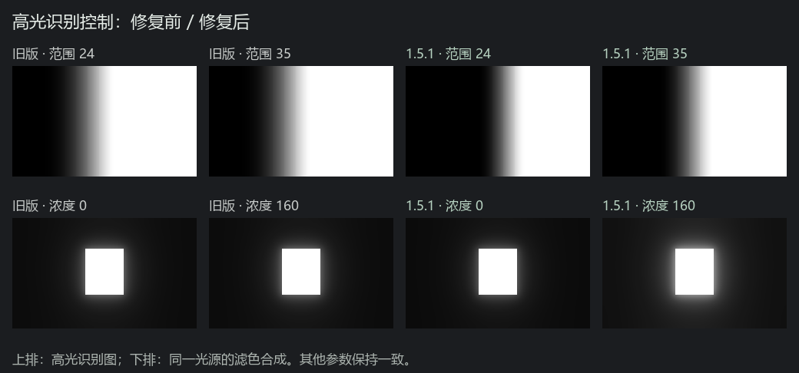

# 高光识别修复 · 1.5.1

## 确认的问题

旧版两个参数确实进入了算法，但没有在所有场景发挥应有作用：

- “发光范围”使用线性门槛，较高数值很快触及下限。灰阶测试中，界面值 24 和 35 的高光识别图完全相同。
- “柔光饱和度”只通过门槛影响哪些像素发光。对白色亮光等已经完全识别的光源，从 0 调到 160 的光晕输出完全相同。

界面值、参数归一化和传参路径均已核对；使用首次计算仍能复现，所以并非只由预览缓存造成。

## 修改与含义

发光范围改为连续的指数门槛映射，保留常用黑柔档位附近的识别水平，高段继续扩大识别区域。“柔光饱和度”增加独立的光雾浓度系数，以数值 20 为原强度基准；因此已被识别的亮光也会随浓度变化。

- 发光范围越大，更多较暗的亮部参与柔光。它不会改变蒙版形状。
- 柔光饱和度越大，光雾越浓。这是历史界面名称，内部参数为 `drCompression`；颜色浓度由独立的 `saturation` 控制。
- 柔光强度控制整体叠加量，扩散范围控制光晕距离。

本次没有调整六档工厂预设数值，也没有改变 Camera Raw 的原生 XMP 预设。不要将这次修复理解为新的实体柔光镜标定。

## 验证

`node --test tests/highlight-controls.test.cjs` 修复前失败：白色亮光的浓度输出差异为 0，高段范围识别图差异为 0。修复后两项均出现像素变化。新增测试还覆盖范围 1、5、15、24、30、35，以及浓度 0、20、40、80、120、160，检查识别范围、输出与缓存一致性。

散射、白柔和状态、局部蒙版、高光识别四组测试全部通过。合成日光纹理的黑柔 1/8、1/4、1/2 暗部平均提亮分别约为 7.29、10.60、16.04 个 8 位灰阶；数值仅描述这张测试图。

本次未重启正在处理照片的 Photoshop；安装后须保存当前光效和照片，再重开 PS，确认版本为 1.5.1。当前修复通过真实渲染代码离线验证，尚未完成新版在 PS 中逐项拖动滑块的检查。广色域和 16 位大图未完整回归。
